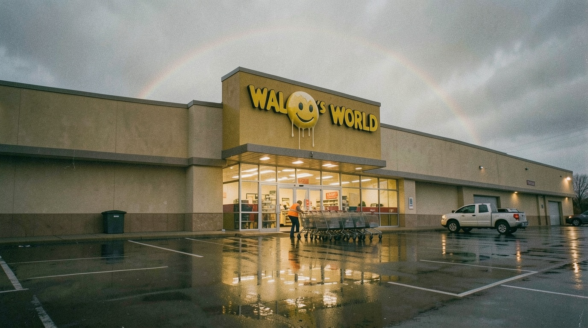
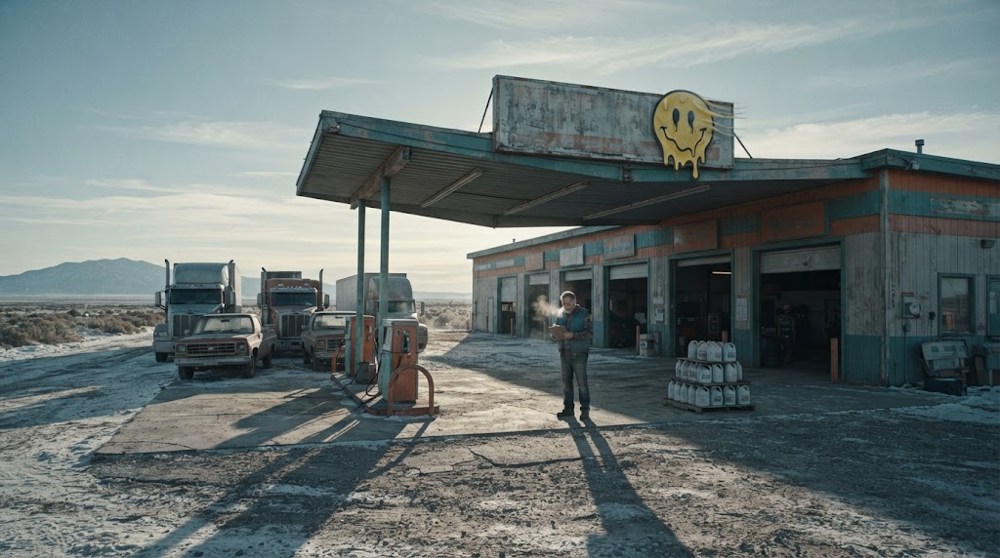
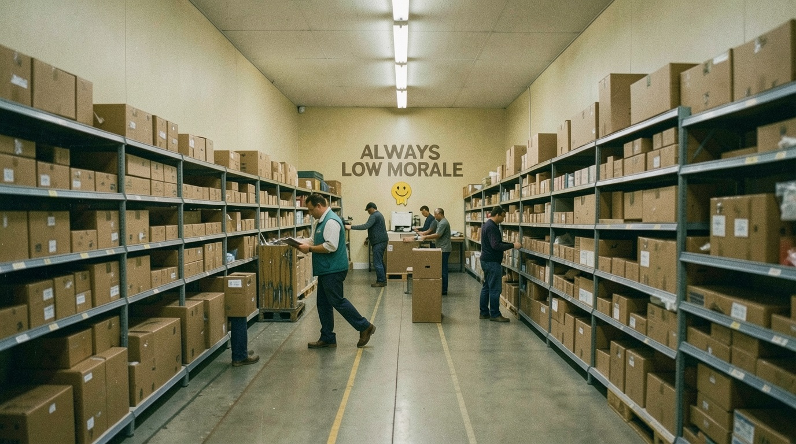
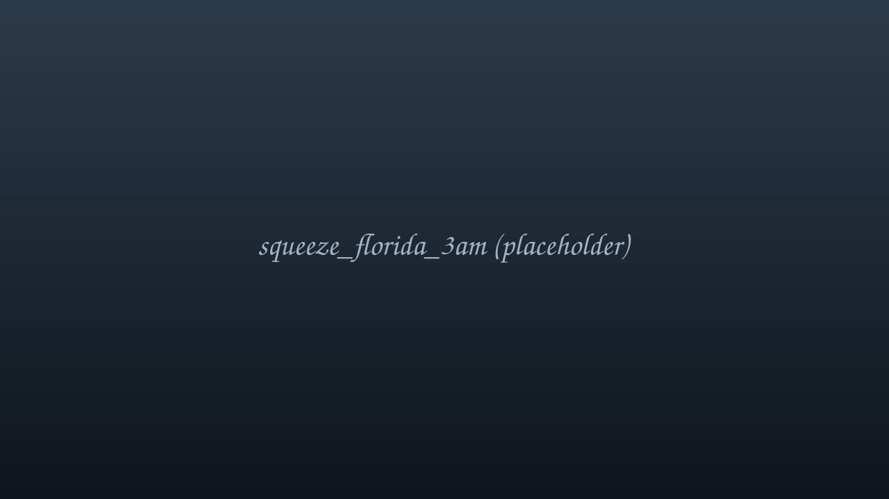
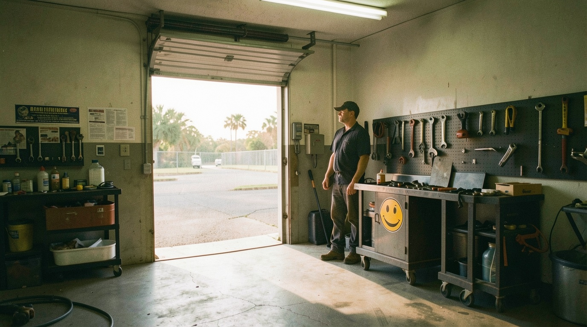

<p align="center">
  <a href="https://ko-fi.com/todd0042">
    
  </a>
</p>

---

# 🛒 Wally's World: The Squeeze

[](https://github.com/Todd0042/wallys-world/releases)
[](LICENSE)
[-3DDC84.svg?logo=android&logoColor=white)](https://developer.android.com)
[](https://developer.android.com/16kb-page-size)
[](https://kotlinlang.org)
[](https://developer.android.com/jetpack/compose)
[](https://github.com/Todd0042/voice-rpg-engine)
[](app/src/main/java/com/voicerpg/engine/audio/SpeechManager.kt)
[](https://developer.android.com/reference/android/speech/SpeechRecognizer)
[](app/src/main/java/com/voicerpg/engine/audio/MusicManager.kt)
[](app/src/test/java/com/voicerpg/engine/)
[](https://ko-fi.com/todd0042)

> **A voice-controlled memoir RPG for Android: live six acts and 33 chapters of big-box retail management, from a 4 AM unload in Utah to a service bay in Florida, speaking every move aloud while Adriana keeps you standing, fully playable with the screen off.**

<p align="center"></p>

---

## 📖 Table of Contents

* **Part 1 — Overview & Quick Start**
  * [🛒 What Is Wally's World?](#-what-is-wallys-world)
  * [⏰ How a Shift Works in 4 Steps](#-how-a-shift-works-in-4-steps)
  * [📦 The Six Acts](#-the-six-acts)
  * [📸 Visual Tour](#-visual-tour)
  * [✨ Highlights at a Glance](#-highlights-at-a-glance)
  * [🚀 Quick Download & Installation](#-quick-download--installation)
* **Part 2 — Technical Documentation & Architecture Reference**
  * [1. Architecture & Engine Integration ([GameContent.kt](app/src/main/java/com/voicerpg/engine/content/GameContent.kt), [manifest.json](app/src/main/assets/game/manifest.json))](#1-architecture--engine-integration)
  * [2. Story: Acts, Chapters & Hubs ([scenes.json](app/src/main/assets/game/story/scenes.json), [nodes.json](app/src/main/assets/game/story/nodes.json))](#2-story-acts-chapters--hubs)
  * [3. One Todd, a Growing Kit ([floor_captain.json](app/src/main/assets/game/classes/floor_captain.json), [todd.json](app/src/main/assets/game/characters/todd.json))](#3-one-todd-a-growing-kit)
  * [4. Adriana, the Support ([adriana_inspiration.json](app/src/main/assets/game/characters/adriana_inspiration.json), [adriana.json](app/src/main/assets/game/characters/adriana.json))](#4-adriana-the-support)
  * [5. Schools, Enemy Types & Weaknesses ([affinity_matrix.json](app/src/main/assets/game/combat/affinity_matrix.json), [enemies.json](app/src/main/assets/game/enemies/enemies.json))](#5-schools-enemy-types--weaknesses)
  * [6. Encounters & Combat Balance ([encounters.json](app/src/main/assets/game/encounters/encounters.json), [balance.json](app/src/main/assets/game/combat/balance.json))](#6-encounters--combat-balance)
  * [7. Voice Recognition & Resonance Scoring ([SpeechManager.kt](app/src/main/java/com/voicerpg/engine/audio/SpeechManager.kt), [ResonanceEngine.kt](app/src/main/java/com/voicerpg/engine/engine/ResonanceEngine.kt))](#7-voice-recognition--resonance-scoring)
  * [8. Music & Speech Ducking ([MusicManager.kt](app/src/main/java/com/voicerpg/engine/audio/MusicManager.kt))](#8-music--speech-ducking)
  * [9. Associate Badge & Selfie Portrait ([SelfiePortraitProcessor.kt](app/src/main/java/com/voicerpg/engine/ui/creation/SelfiePortraitProcessor.kt), [selfie_filters.json](app/src/main/assets/game/creation/selfie_filters.json))](#9-associate-badge--selfie-portrait)
  * [10. Pocket Mode, Pure Story Mode & Voice Commands ([commands_en.json](app/src/main/assets/game/commands/commands_en.json), [PocketModeTouchGuard.kt](app/src/main/java/com/voicerpg/engine/ui/pocket/PocketModeTouchGuard.kt))](#10-pocket-mode-pure-story-mode--voice-commands)
  * [11. Engine Sync Workflow ([.engine-sync/](.engine-sync/OWNED_PATHS))](#11-engine-sync-workflow)
  * [12. Repository Structure](#12-repository-structure)
  * [13. Tests & Build ([BalanceContractTest.kt](app/src/test/java/com/voicerpg/engine/balance/BalanceContractTest.kt))](#13-tests--build)
  * [14. Ethics, Provenance & Licensing ([LICENSE](LICENSE), [LICENSE-MEDIA](LICENSE-MEDIA))](#14-ethics-provenance--licensing)

---

# Part 1 — Overview & Quick Start

## 🛒 What Is Wally's World?

**Wally's World** (in-game title **The Squeeze: A Wally's World Memoir**) is a narrative voice RPG for Android, built on the shared **[VoiceRPG Engine](https://github.com/Todd0042/voice-rpg-engine)**. It is a gritty, realistic memoir of years in retail management at a fictional megastore chain: overnight freight, a service shop, grievances stamped "Unsubstantiated", relocation contracts, shingles outbreaks and a 3 AM that nearly ends everything. It is not a power fantasy; winning means getting out with your sanity, your empathy and your life intact.

You play **Todd** (the default name; you can pick your own), and you speak everything aloud: story choices, combat moves, targets and system commands.

1. **The story**: 33 chapters in six acts, narrated by text-to-speech with a distinct voice per character.
2. **The fights**: 40 encounters where the "enemies" are what the job throws at you (a freight wall, a poisoned email, a regional audit, the pay cut) and your moves are ways of getting through a shift.
3. **The support**: Todd's wife **Adriana**, who fights beside him in person four times and, everywhere else, as **Adriana's Inspiration**, an untargetable presence who only heals.

---

## ⏰ How a Shift Works in 4 Steps

1. **Clock in**: enter a name and title on your associate badge, optionally from a selfie. There is no class to choose.
2. **Listen**: the narrator and the cast speak each scene; say a choice aloud (or say *"Read choices"* to hear them).
3. **Speak your moves**: in battle, say a move and a target (*"Volt Snap the Fluorescent Hum"*, *"Lifeline Mend Todd"*). The way you say it sets its **resonance**, a 1.0x to 3.0x multiplier.
4. **Grow through the story**: there is no mana and no levelling. Todd starts with three moves and learns nine more at story milestones.

---

## 📦 The Six Acts

| Act | Title (from [`scenes.json`](app/src/main/assets/game/story/scenes.json)) | Chapters | Where | Fights |
|---|---|---|---|---|
| **I** | The Utah Grind | 1 to 4 | A Wally's World megamart in Utah: the overnight unload, the sales floor, the front end, the manager's office | 3 |
| **II** | The Lamar Squeeze | 5 to 9 | The highway-oasis service shop and store in Lamar, Colorado | 5 |
| **III** | The Borderlands Squeeze | 10 to 14 | A neglected service shop on the Georgia–South Carolina border | 6 |
| **IV** | The Madness | 15 to 21 | Pueblo, Colorado: the one-man close, the freight overhaul, Number One in the Nation, the overnight shift | 12 |
| **V** | The Crucible | 22 to 27 | St. Augustine, Florida, under a relocation contract, with a commute from Jacksonville | 9 |
| **VI** | The Aftermath | 28 to 33 | After the $24,000 pay cut: new store managers, the front end, and the shop tech pit | 5 |

---

## 📸 Visual Tour

There are no gameplay screenshots in the repository yet; these are story backgrounds the game shows (landscape versions; each has a portrait `_p` twin).

### Acts I to III

| **Act I: The 4 AM Unload** | **Act II: The Highway Oasis** | **Act III: The State Line Commute** |
|:---:|:---:|:---:|
|  |  |  |
| *The backroom trench at 3:47 AM, forty-eight feet of freight on the trailer.* | *The Lamar service shop where Todd becomes Shop Manager.* | *Crossing into the neglected Borderlands shop.* |

### Acts IV to VI

| **Act IV: Number One in the Nation** | **Act V: The 3 AM** | **Act VI: The Unbroken Soul** |
|:---:|:---:|:---:|
|  |  |  |
| *The Pueblo freight floor, rebuilt into one machine.* | *The backroom at 3 AM, the setting of the game's solemn fight.* | *The shop bay where the story closes.* |

---

## ✨ Highlights at a Glance

* **🗣️ Speak every move**: Todd's kit is real job skills, such as **Line Drill**, **Freight Push**, **Volt Snap**, **Coolant Chill**, **Hold Ground** and **Root Cause**; say the name, add a target, and the clearer and fuller your delivery, the harder it lands.
* **📈 A kit that grows with the story**: 3 starting moves and 9 more learned at story milestones, 12 by the end; nothing is ever replaced, and no mana to manage.
* **🦺 A costume change**: from the chapter Todd takes over the Lamar shop, he fights in a shop manager's outfit.
* **💞 Adriana as the support**: **The Backrub** heals the whole party by 20% of max HP, **Lifeline Mend** heals the named teammate by 45%, and in person she hits back with **Truth Smite**.
* **🎯 Enemy types with weaknesses**: seven schools of move (Grunt Work, Know-How, Cool Head, Fired Up, Integrity, Back Channels, Growth) against seven kinds of enemy (Management, Metrics, The Building, The Public, Inner Demons, Corporate, Paperwork), plus per-enemy weaknesses, resistances and armor.
* **⚖️ Balanced by simulation**: every story fight is played by the engine's battle simulator and tuned so a sensible player wins, a careless one can lose late bosses, and healing never takes over.
* **🕯️ A solemn 3 AM**: the fight against **The Alternative** silences callouts, taunts and victory fanfare and closes on one spoken line.
* **📵 Screenless Pocket Mode**: a true-black touch guard and spoken status reports let you play the whole game with the phone in your pocket.
* **🎧 Pure Story Mode**: fights play themselves (and always win) so the memoir can be heard like an audiobook.
* **🌐 Six languages of voice commands**: English, German, Spanish, French, Italian and Portuguese, with story translations for the five non-English languages.

---

## 🚀 Quick Download & Installation

### Android (release APK)

1. Download **`app-debug.apk`** from the latest [release](https://github.com/Todd0042/wallys-world/releases) (v1.23.0).
2. Install it on any Android 8.0+ device (API 26 or higher); allow installs from your browser or file manager if asked.
3. Tap **Allow** when the game asks for microphone access.

```bash
# Or install from a computer with ADB:
adb install -r app-debug.apk
```

### Run from source

The engine sync scripts expect the engine repository next to this one.

```bash
# Clone the game and the shared engine side by side
git clone https://github.com/Todd0042/wallys-world.git
git clone https://github.com/Todd0042/voice-rpg-engine.git
cd wallys-world

# Build a debug APK (JDK 17, Android SDK 34) and install it on a connected phone
./gradlew assembleDebug
adb install -r app/build/outputs/apk/debug/app-debug.apk

# Check that the APK is 16 KB page-size compatible
bash ../voice-rpg-engine/scripts/check_16kb.sh app/build/outputs/apk/debug/app-debug.apk
```

---

# Part 2 — Technical Documentation & Architecture Reference

> *The sections below are a code-verified engineering reference: every file, field and number is taken from the current source and content.*

## 1. Architecture & Engine Integration

Wally's World is a **content pack** on the source-available **[VoiceRPG Engine](https://github.com/Todd0042/voice-rpg-engine)**. The same engine code runs in every VoiceRPG game; this repository holds the game's JSON content, art, music and app identity.

```
+------------------------------------------------------------------+
|  WALLY'S WORLD (this repo)                                       |
|  app/src/main/assets/game/**  story, characters, spells, enemies |
|  app/src/main/assets/{story,portraits,environments,audio}/       |
|  app/build.gradle.kts         applicationId com.wallysworld.app  |
+------------------------------------------------------------------+
                 |  loaded at boot by GameContent.kt
                 v
+------------------------------------------------------------------+
|  VOICERPG ENGINE (read-only copy, com.voicerpg.engine.*)         |
|  audio/    SpeechManager, MusicManager, CombatNarrator           |
|  engine/   ResonanceEngine, IntentParser, SpellThesaurus         |
|  combat/   DamageResolver, AffinityTable, AutoPlayer, EnemyBrain |
|  viewmodel/ StoryViewModel, CombatViewModel                      |
|  ui/       Jetpack Compose screens (story, combat, pocket, ...)  |
+------------------------------------------------------------------+
```

The engine code under `app/src/main/java/com/voicerpg/engine/`, the command and localization files, and the engine tests are exact copies listed in [`.engine-sync/OWNED_PATHS`](.engine-sync/OWNED_PATHS); a pre-commit hook and CI ([`engine_guard.yml`](.github/workflows/engine_guard.yml)) reject edits to them.

### Manifest settings that shape this game ([`manifest.json`](app/src/main/assets/game/manifest.json))

| Field | Value | Effect |
|---|---|---|
| `gameTitle` / `gameSubtitle` | The Squeeze / A Wally's World Memoir | Title screen |
| `combatResource` | `none` | No mana bar; moves have no cost |
| `allowClassSelectionInCreation` | `false` | No class picker; Todd's one class is `floor_captain` |
| `initialSceneId` / `initialNodeId` | `scene_utah_trench` / `squeeze_intro` | Where a new game starts |
| `defaultHeroName` / `defaultHeroTitle` | Todd / Freight Supervisor | Badge defaults; `characterTitles` lists six alternatives |
| `resonance.mode` | `SURVIVAL` | Resonance profile tuned for short, urgent commands (section 7) |
| `ttsReplacements` | `St.` → `Saint` | So TTS reads "Saint Augustine" |

---

## 2. Story: Acts, Chapters & Hubs

The story is **33 scenes** (one per chapter) in [`scenes.json`](app/src/main/assets/game/story/scenes.json) and **382 dialogue nodes** in [`nodes.json`](app/src/main/assets/game/story/nodes.json); 39 nodes start a battle (`triggerBattleEncounterId`).

| Act | Chapters (`chapterTitle`) |
|---|---|
| **I: The Utah Grind** | 1 The 4 AM Unload · 2 The Promotion · 3 The Rot and the Offer · 4 The Office |
| **II: The Lamar Squeeze** | 5 The Highway Oasis · 6 The Fall of Miss Trudy · 7 The Brick Wall · 8 The Christmas Party Slur · 9 The Body Keeps the Score |
| **III: The Borderlands Squeeze** | 10 The State Line Commute · 11 The Gated Hierarchy · 12 The Paralysis of Kindness · 13 The Safety Breach · 14 The Body Keeps the Score |
| **IV: The Madness** | 15 The One-Man Close · 16 The Overhaul Offer · 17 Number One in the Nation · 18 The Education of Richard · 19 The Paradox of Jay-Dau · 20 The Graveyard · 21 The Fatal Step |
| **V: The Crucible** | 22 The Asphalt Gauntlet · 23 The Honeymoon · 24 The Flip · 25 The Hostage Hours · 26 The Sanctuary · 27 The 3 AM |
| **VI: The Aftermath** | 28 The Pay Cut · 29 The Brief Sanctuary · 30 Abdoolie's Ghost · 31 The Customer Gauntlet · 32 The Underground Haven · 33 The Unbroken Soul |

### Hubs

Story hubs (such as `floor_hub`, `lamar_hub`, `carolina_hub`, `florida_honeymoon_hub`) offer several branches. Each branch sets its own flag on entry (`setFlagOnEnter`), a choice whose `completionFlag` is already set is removed so the player can't loop, and the hub moves on once every branch is done. Several of these flags are also the milestones at which Todd and Adriana learn moves (sections 3 and 4).

### Cast

22 character files in [`characters/`](app/src/main/assets/game/characters/), with portraits in [`assets/portraits/`](app/src/main/assets/portraits/): Todd (`hero`, plus `todd_shop` as a dialogue speaker), Adriana and Adriana's Inspiration, the narrator, and the managers and crews of each store (Mattie-T, Jodie, Miss Trudy, Jury, Azalia, Richard, Jay-Dau, Amandy, Steffie, Sriniviii, Ohmar, Timmy, Abdoolie, Aussie, Cap'n Skagg, Tani, Cap'n H). Names, titles and the chain itself are fictional.

---

## 3. One Todd, a Growing Kit

There is **no class choice** at character creation and Todd has one class, [`classes/floor_captain.json`](app/src/main/assets/game/classes/floor_captain.json) (340 HP, speed 58). **Todd (`hero`) fights in all 40 encounters.** The game has **no mana and no levels**: Todd starts with three moves (`starterSpellIds`) and gains the rest through nine `spellGrants`, each keyed to a hub beat every playthrough passes, for **12 moves by the end**. Grants only ever add.

| When (story beat that sets the flag) | Todd learns | School |
|---|---|---|
| Start | **Line Drill**, **Volt Snap**, **Mend Crew** (heals the teammate you name, or himself, by 15% of max HP) | Grunt Work, Know-How, Integrity |
| Act I, Ch. 2: leading the overnight crew (`flag_floor_led`) | **Freight Push** (hits all) | Grunt Work |
| Act I, Ch. 3: watching the front end rot (`flag_front_rot_seen`) | **Grind Out** | Grunt Work |
| Act II, Ch. 5: taking over the Lamar shop (`flag_todd_shop`) | **Coolant Chill** | Cool Head |
| Act II, Ch. 5: rebuilding the bays (`flag_lamar_bays`) | **Bay Heat** (hits all) | Fired Up |
| Act II, Ch. 6: shielding the techs from Jury (`flag_fall_shield`) | **Hold Ground** (guard: halves the next hit) | Grunt Work |
| Act III, Ch. 10: earning the Borderlands techs' trust (`flag_carolina_crew`) | **Backroom Whisper** | Back Channels |
| Act IV, Ch. 17: rebuilding the Pueblo unload (`flag_pueblo_unload`) | **Root Cause** | Growth |
| Act V, Ch. 23: meeting the Florida crew (`flag_florida_crew_met`) | **Morning Surge** (hits all) | Know-How |
| Act VI, Ch. 28: the pay cut's arithmetic (`flag_act6_crash_financial`) | **Searing Shift** | Fired Up |

[`characters/todd.json`](app/src/main/assets/game/characters/todd.json) mirrors the starting kit for the tutorial and carries Todd's **costume**: from `flag_todd_shop` (taking over the Lamar shop, Act II, Ch. 5) he fights as the `todd_shop` sprite, in his shop manager's outfit (`costumes`).

### Shop skills left out

Six Shop Captain moves (Lube Line, Tire Grind, Bay Charge, Grease Clear, Jack Hold, Belt Mend) are still defined in [`spells/spells.json`](app/src/main/assets/game/spells/spells.json) but are not in Todd's kit, because each overlaps one he already learns and the spell console is built for 10 to 12. [`docs/SHOP_SKILLS_LEFT_OUT.md`](docs/SHOP_SKILLS_LEFT_OUT.md) lists them and shows how to bring one back with a single grant.

---

## 4. Adriana, the Support

| Fighter | Fights | Starts with | Learns |
|---|---|---|---|
| **Adriana's Inspiration** ([`adriana_inspiration.json`](app/src/main/assets/game/characters/adriana_inspiration.json)): untargetable, never attacks | 36 | **The Backrub** (heals the whole party by 20% of max HP), **Lifeline Mend** (heals the named teammate by 45% of max HP; with no name it finds Todd), **Inspiring Words** (cleanses the party's debuffs) | **Quiet Remember** (targetable heal + Bless), Act III, Ch. 10 (`flag_carolina_home`) |
| **Adriana in person** ([`adriana.json`](app/src/main/assets/game/characters/adriana.json)): 280 HP | 4 (The Brick Wall, The Christmas Party Slur, The 3 AM, The Final Balance Sheet) | The Backrub, Lifeline Mend, **Truth Smite** (her one attack), Steady Presence, Unbroken Aegis | **Calm Rebuke** (Integrity, hits all), Act II, Ch. 8 (`flag_hall_adriana`); **Frozen Out** (Cool Head), Act V, Ch. 22 (`flag_florida_anchor_held`) |

Percentage heals are multiplied by resonance (`maxHp × healPctOfMax × resonance`, so 20% at x1.5 is 30%). Every move in the game, 53 in all, is defined in [`spells/spells.json`](app/src/main/assets/game/spells/spells.json), with spoken synonyms in [`spells/thesaurus.json`](app/src/main/assets/game/spells/thesaurus.json).

---

## 5. Schools, Enemy Types & Weaknesses

The engine's ids stay generic; [`combat/affinity_matrix.json`](app/src/main/assets/game/combat/affinity_matrix.json) gives them this game's display and spoken names (`schoolNames`, `familyNames`). The design behind them is in [`docs/ENEMY_TYPES_PROPOSAL.md`](docs/ENEMY_TYPES_PROPOSAL.md).

### Schools (ways of working)

| Engine id | Name | Todd's and Adriana's moves |
|---|---|---|
| PHYSICAL | **Grunt Work** | Line Drill, Freight Push, Grind Out, Hold Ground |
| ELECTROMANCY | **Know-How** | Volt Snap, Morning Surge |
| CRYOMANCY | **Cool Head** | Coolant Chill, Frozen Out |
| PYROMANCY | **Fired Up** | Bay Heat, Searing Shift |
| HOLY | **Integrity** | Mend Crew, Truth Smite, Calm Rebuke and every Adriana heal |
| SHADOW | **Back Channels** | Backroom Whisper |
| NATURE | **Growth** | Root Cause |

### Enemy families (what wears you down)

56 enemy templates in [`enemies/enemies.json`](app/src/main/assets/game/enemies/enemies.json), across all seven families. Multipliers from the matrix (floor 0.8, so nothing is immune; ceiling 2.0):

| Engine id | Name | Templates | Strong against it | Weak against it (0.8) |
|---|---|---|---|---|
| FLESH | **Management** | 11 | Integrity, Back Channels (1.5) | none |
| UNDEAD | **Metrics** | 6 | Know-How (2.0), Growth (1.5) | Integrity |
| CONSTRUCT | **The Building** | 9 | Grunt Work (1.5) | Growth, Back Channels |
| VERDANT | **The Public** | 8 | Cool Head (1.5) | Fired Up |
| VOID | **Inner Demons** | 6 | Growth (2.0), Cool Head, Integrity (1.5) | Fired Up, Back Channels, Grunt Work |
| RADIANT | **Corporate** | 6 | Integrity (2.0) | Know-How, Growth |
| SILENCE | **Paperwork** | 10 | Fired Up (2.0) | Cool Head |

On top of the family, an enemy can list its own `weak` schools (x2.0, 31 enemies) and `resist` schools (x0.8, 30 enemies), and carry `armor` (15 or 35, on 26 enemies): armor takes its value off every Grunt Work blow, Know-How (lightning) conducts through it for 25% more damage, and other schools ignore it. Affinity applies only to a move's base power; the resonance multiplier is never discounted by a matchup ([`DamageResolver.kt`](app/src/main/java/com/voicerpg/engine/combat/DamageResolver.kt)).

---

## 6. Encounters & Combat Balance

[`encounters/encounters.json`](app/src/main/assets/game/encounters/encounters.json) defines **40 encounters**: 36 with Todd and Adriana's Inspiration, 4 with Todd and Adriana in person. 31 have boss phases that fire when a named enemy drops below an HP threshold.

| Act | Encounters |
|---|---|
| I | The 4 AM Unload, Front-End Storm, The Manager's Office (Mattie-T) |
| II | The Friday Oil Rush, The Purge Audit, The Brick Wall, The Christmas Party Slur (Jury), The Body Keeps the Score |
| III | The Neglected Bays, The Executive Walkthrough, Store Manager Azalia, The Scapegoat Investigation, The Regional Desk, The Body Keeps the Score (Again) |
| IV | The Front-End Swarm, The One-Man Close, The Blotter Regulars, The Claim Blizzard, The Parking Lot Draw, The Freight-to-Floor, The Compliance Walkthrough, Store Manager Jay-Dau, Store Lead Amandy, The Overnight Meat Grinder, The Body Keeps the Score (Third Entry), The Relocation Contract |
| V | The Asphalt Gauntlet, The Green Meters, Sriniviii's Morning Verdict, Ohmar's Formal Office, The Ownerless Building, The Fourth Signal, The Redemption Schedule, **The 3 AM**, The Parting Shot |
| VI | The Pay Cut, Store Manager Abdoolie, The Customer Gauntlet, The All-Hands Inquisition (Aussie), The Final Balance Sheet |

The Claim Blizzard is defined but no story node currently triggers it.

### The 3 AM

`florida_three_am` pits Todd and Adriana against **The Alternative**, The Arithmetic of the Machine and The Hum of the Silent Store. It is marked `"solemn": true`, which silences tag callouts, taunts and victory fanfare, and ends on its `endLine`: *"You made it through the night."*

### Combat balance

**Combat balance.** Every story fight is played by the engine's battle simulator (`BalanceContractTest`: the real combat on virtual time, with the party and spells the story has given them at that point): 38 story fights. A sensible player at the balance point (**x1.5** resonance, [`combat/balance.json`](app/src/main/assets/game/combat/balance.json)) should win in a target number of rounds with a safety margin that narrows toward the finale, a lazy x1.1 player should be able to lose late bosses, healing should never take over a fight (at most 34% of turns), and Pure Story Mode must win every fight. The enemy HP and attack in [`encounters.json`](app/src/main/assets/game/encounters/encounters.json) were tuned to those targets with the engine's `BalanceTunerTest`; the report of every fight is written to `app/build/reports/balance.txt` (it reports rather than fails the build, since `balance.json` doesn't set `enforce`: a handful of fights still sit just outside a target).

---

## 7. Voice Recognition & Resonance Scoring

### Speech loop ([`SpeechManager.kt`](app/src/main/java/com/voicerpg/engine/audio/SpeechManager.kt), [`IntentParser.kt`](app/src/main/java/com/voicerpg/engine/engine/IntentParser.kt))

* Recognition runs **on the device**: `SpeechRecognizer.createOnDeviceSpeechRecognizer` where available, with `EXTRA_PREFER_OFFLINE`.
* **Chime suppression** (on by default) briefly mutes the notification and system streams while the mic opens, so the OS beep never plays; game audio and TTS stay on the music stream.
* With **auto-listen**, the mic re-arms after each line of narration; otherwise it is tap-to-speak.
* `IntentParser` maps what you said to a move (by name or any alias in [`thesaurus.json`](app/src/main/assets/game/spells/thesaurus.json)), a target, a story choice or a meta-command.

### Resonance ([`ResonanceEngine.kt`](app/src/main/java/com/voicerpg/engine/engine/ResonanceEngine.kt), [`ResonanceResult.kt`](app/src/main/java/com/voicerpg/engine/model/ResonanceResult.kt))

Each spoken move earns a **bonus of 0 to 200%**; the damage (or heal) multiplier is `1.0 + bonus / 100`, so **1.0x to 3.0x**. The bonus adds up five dimensions, then a repetition decay if you just said the same thing:

| Dimension | Up to | Measured from |
|---|---|---|
| Lexical length | +45 | Word count of the utterance |
| Thematic roots | +45 | Matches against the move's school in [`SpellThesaurus.kt`](app/src/main/java/com/voicerpg/engine/engine/SpellThesaurus.kt) |
| Volume projection | +40 | Acoustic volume score |
| Inflection | +40 | Pitch and dynamics score |
| Novelty | +30 | Fresh phrasing (a novelty cache penalises repeats) |

Wally's World uses the **`SURVIVAL`** profile: it rewards short urgent commands (`conciseCommandBonus`), gives the full thematic bonus to a single matched root, swaps the poetic-phrasing bonus for an **urgency bonus** of +12 ("now", "focus", "dig deep"...), and raises acoustic sensitivity to 1.25.

| Tier | Bonus | Chant the game suggests (`resonance.tierChants`) |
|---|---|---|
| **Basic** | 0 to 19% | `{name}` |
| **Adept** | 20 to 54% | `{name}!` |
| **Master** | 55 to 99% | `Focus now: {name}!` |
| **Mythic** | 100 to 154% | `Stay on it: {name} now!` |
| **Transcendental** | 155 to 200% | `Dig deep, clear the lane, and survive: {name} now!` |

### Speed and turns

Combat is ATB: each living fighter's gauge advances every tick by `speed / 100 × 0.035`, modified by statuses (chill slows, bless quickens), and acts when full ([`CombatViewModel.kt`](app/src/main/java/com/voicerpg/engine/viewmodel/CombatViewModel.kt)).

---

## 8. Music & Speech Ducking

[`MusicManager.kt`](app/src/main/java/com/voicerpg/engine/audio/MusicManager.kt) loops a track per scene (`musicAsset` in `scenes.json`) from [`assets/audio/music/`](app/src/main/assets/audio/music/), which holds a title, exploration and combat track and one per act (for example `bgm_act3_borderlands.ogg`, `bgm_act6_aftermath.ogg`).

* **Speech ducking**: while TTS speaks, music drops to **22%** of the user's volume (`DUCK_RATIO = 0.22`) and fades back afterwards.
* **System ducking**: when Android asks (for example a navigation prompt), music drops to 30%.
* Music is played with media audio attributes and holds audio focus, which keeps Bluetooth and car audio awake so the first syllables of dialogue aren't clipped.

---

## 9. Associate Badge & Selfie Portrait

Character creation ([`CharacterCreationScreen.kt`](app/src/main/java/com/voicerpg/engine/ui/creation/CharacterCreationScreen.kt)) asks for a **name** (quick picks: Todd, Richard, Jodie, Adriana, Skagg), a **title** (Freight Supervisor, Shop Manager, Team Lead, Overnight Associate, Floor Captain, Service Steward) and an **aura colour**; there is no class step.

An optional **selfie badge** ([`SelfiePortraitProcessor.kt`](app/src/main/java/com/voicerpg/engine/ui/creation/SelfiePortraitProcessor.kt), configured by [`selfie_filters.json`](app/src/main/assets/game/creation/selfie_filters.json)) starts with the game's memoir advisory, then processes the photo entirely on the device:

| Step (label in the badge filter) | What it does |
|---|---|
| **Warehouse Background** | ML Kit Selfie Segmentation cuts you out and places you over one of five store backgrounds (Trench, Break Room, Sales Floor, Service Bay, Overnight Lot) |
| **Raccoon Eyes** | Dark exhaustion circles placed from ML Kit face landmarks |
| **3 AM Fluorescents** | A cold cyan colour grade, like store ballast light |
| **CRT Scanlines** | Surveillance-monitor scanlines, plus a dark vignette |

Each effect except the vignette can be switched off in the filter dialog.

---|---|
| Background cutout | ML Kit Selfie Segmentation places you over one of five store backgrounds (Trench, Break Room, Sales Floor, Service Bay, Overnight Lot) |
| Raccoon Eyes | Dark exhaustion circles from face landmarks (ML Kit face detection) |
| Colour grade | The game's washed-out grade |
| Pixel art | Kuwahara filter, 144 px grid, palette quantisation and 1 px inking |
| TFLite stylisation | Optional, through LiteRT, when a filter config names a model |

---

## 10. Pocket Mode, Pure Story Mode & Voice Commands

* **Pocket Mode** ([`PocketModeTouchGuard.kt`](app/src/main/java/com/voicerpg/engine/ui/pocket/PocketModeTouchGuard.kt)): a true-black (#000000) full-screen touch guard that blocks pocket touches and saves battery on OLED screens; everything else continues by voice.
* **Pure Story Mode**: battles are played automatically by the engine's `FASTEST` policy ([`AutoPlayer.kt`](app/src/main/java/com/voicerpg/engine/combat/AutoPlayer.kt)), and the balance contract requires it to win every fight.
* **Meta-commands** (English phrases from [`commands_en.json`](app/src/main/assets/game/commands/commands_en.json); German, Spanish, French, Italian and Portuguese files sit beside it):

| Say | Does |
|---|---|
| *"Status"*, *"Enemies"* | Spoken party or enemy report |
| *"Pocket mode"*, *"Lock screen"* | Eyes-free mode, the pocket touch guard |
| *"Auto listen"* | Re-arm the mic after every line |
| *"Toggle narration"*, *"Read choices"* | Narration on/off; read the current choices aloud |
| *"Options"*, *"Log"*, *"Recap"* | Options menu, dialogue backlog, story so far |
| *"Skip"*, *"Help"* | Fast-forward dialogue; list what you can say |

Translations of the game's story text are in [`translations/`](app/src/main/assets/game/translations/) (`strings_de/es/fr/it/pt.json`).

---

## 11. Engine Sync Workflow

Engine changes are made in `../voice-rpg-engine` and pushed to every game; this repo never edits engine files.

```bash
# In the engine: run its tests, then its suite against every game's content
cd ../voice-rpg-engine
./gradlew testDebugUnitTest
./scripts/test_content_packs.sh wallys-world

# Push the engine into the games and run each game's tests
./scripts/sync_engine_to_games.sh --verify wallys-world

# Report which games are in sync
./scripts/sync_engine_to_games.sh --check
```

The synced engine version is recorded in [`.engine-sync/ENGINE_VERSION`](.engine-sync/ENGINE_VERSION), with checksums in [`.engine-sync/MANIFEST.sha256`](.engine-sync/MANIFEST.sha256) and the guard in [`.engine-sync/guard.sh`](.engine-sync/guard.sh).

---

## 12. Repository Structure

```
wallys-world/
├── app/
│   ├── build.gradle.kts                  # App id com.wallysworld.app, version 1.23.0, dependencies
│   └── src/
│       ├── main/
│       │   ├── java/com/voicerpg/engine/ # VoiceRPG engine (read-only synced copy)
│       │   ├── assets/
│       │   │   ├── game/
│       │   │   │   ├── manifest.json     # Title, start node, combatResource none, SURVIVAL resonance
│       │   │   │   ├── story/            # scenes.json (33 chapters), nodes.json (382 nodes)
│       │   │   │   ├── characters/       # 22 characters: Todd, Adriana, the cast
│       │   │   │   ├── classes/          # floor_captain.json: Todd's kit and story grants
│       │   │   │   ├── spells/           # spells.json (53 moves), thesaurus.json
│       │   │   │   ├── enemies/          # enemies.json (56 templates), enemy_spells.json, enemy_sprites.json
│       │   │   │   ├── encounters/       # encounters.json (40 fights)
│       │   │   │   ├── combat/           # affinity_matrix.json, balance.json, status_catalog.json
│       │   │   │   ├── creation/         # selfie_filters.json (associate badge)
│       │   │   │   ├── environments/     # environments.json (battle backdrops)
│       │   │   │   ├── sprites/          # sprites.json; sheets/: 53 battle sprite sheets (PNG + Aseprite JSON)
│       │   │   │   ├── translations/     # Story text in de, es, fr, it, pt
│       │   │   │   ├── commands/         # Voice commands, 6 languages (engine-owned)
│       │   │   │   └── localization/     # Engine UI phrases (engine-owned)
│       │   │   ├── story/                # Chapter backgrounds, landscape and portrait (_p)
│       │   │   ├── portraits/            # Character portraits
│       │   │   ├── environments/         # Battle and badge backgrounds
│       │   │   └── audio/music/          # Title, exploration, combat and per-act tracks (.ogg)
│       │   └── res/                      # App name, launcher icons
│       └── test/java/com/voicerpg/
│           ├── engine/                   # Engine test suite (read-only synced copy)
│           └── game/                     # Wally's World tests (combat, content, story)
├── .engine-sync/                         # Engine version, checksums, guard, release gate
├── .github/workflows/engine_guard.yml    # CI check that engine files match the synced version
├── art/                                  # sprite_roster.json, SPRITE_BRIEFS.md (battle sprite plan), sprite-previews/
├── docs/
│   ├── ENEMY_TYPES_PROPOSAL.md           # School and family names, matrix, per-enemy weaknesses
│   ├── SHOP_SKILLS_LEFT_OUT.md           # The six Shop Captain moves not in Todd's kit
│   └── combat-design/                    # Earlier combat redesign planning artifacts
├── project-guide/                        # Story bible: overview and one file per act
├── DESIGN.md                             # Engine architecture specification
├── STARTER_GUIDE.md                      # Engine game-creation guide
├── TODO.md                               # Roadmap
├── allies.md                             # Planning roster of possible companions
├── LICENSE                               # PolyForm Noncommercial 1.0.0
└── LICENSE-MEDIA                         # CC BY-NC 4.0 for Todd's media
```

---

## 13. Tests & Build

Wally's World runs **392 automated unit tests** (the engine's suite against this game's content, plus the game's own tests), covering choice matching, hub gating, save state integrity, multi-language commands, Adriana's Inspiration in combat and combat balance. Game-specific tests live in [`app/src/test/java/com/voicerpg/game/`](app/src/test/java/com/voicerpg/game/).

```bash
# Run all unit tests (writes the balance report to app/build/reports/balance.txt)
./gradlew testDebugUnitTest

# Only the balance contract
./gradlew testDebugUnitTest --tests "*BalanceContractTest*"

# Build the debug APK and check 16 KB alignment
./gradlew assembleDebug
bash ../voice-rpg-engine/scripts/check_16kb.sh app/build/outputs/apk/debug/app-debug.apk
```

A release build (`assembleRelease`, `bundleRelease`) also runs the release gate in [`.engine-sync/release_gate.gradle.kts`](.engine-sync/release_gate.gradle.kts), which checks the battle sprite contract.

---

## 14. Ethics, Provenance & Licensing

### 📜 Provenance

* **A memoir, fictionalised**: the story is drawn from its author's own years in retail management. Store, chain, character names and titles are deliberately fictional.
* **AI-assisted development**: the game content and the engine were written with the help of AI coding agents, under the author's direction.

### 🔒 Privacy

* Speech recognition runs on the device, and the selfie badge is processed on the device and never uploaded. The game has no accounts and includes no analytics or telemetry library.

### ⚖️ Software License & Commercial Inquiries

* **Non-Commercial Use (Free, Source-Available)**: Wally's World's code is licensed for personal, hobbyist, educational, and non-commercial use under the **[PolyForm Noncommercial License 1.0.0](LICENSE)**.
* **Commercial Licensing Inquiries**: commercial use (inside a company, in a paid product or service, or for profit) requires a separate license from [Todd0042](https://github.com/Todd0042).
* **Media License**: the images, artwork, icons and music made for this project (the paths listed in [LICENSE-MEDIA](LICENSE-MEDIA)) are © Todd0042 under **[CC BY-NC 4.0](LICENSE-MEDIA)**: free to share and adapt with credit for non-commercial purposes; commercial use requires permission.
* **Third-party components**: Android, Jetpack Compose, ML Kit, LiteRT, Gson and the other libraries in [`app/build.gradle.kts`](app/build.gradle.kts) keep their own licenses.

---

<p align="center">
  If you enjoy Wally's World, consider supporting its development:<br/><br/>
  <a href="https://ko-fi.com/todd0042" target="_blank">
    
  </a>
</p>

---

<p align="center">
  <a href="https://ko-fi.com/todd0042">
    
  </a>
</p>
